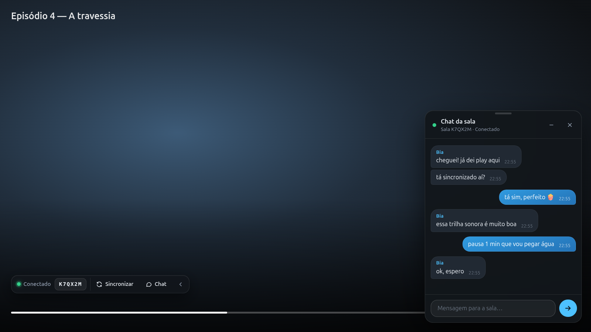
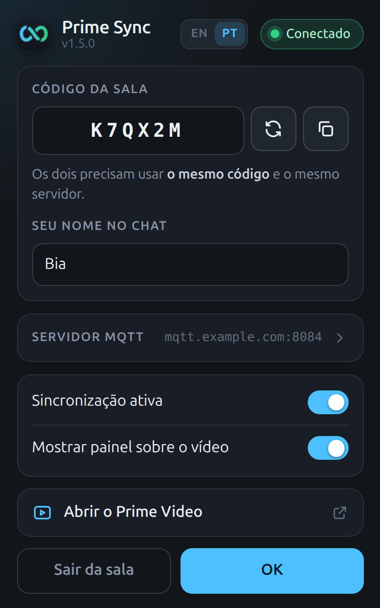

<p align="center">
  
</p>

<h1 align="center">Prime Sync</h1>

<p align="center">
  Assistam Prime Video juntos, cada um na sua casa.<br>
  Quando um dá play, pausa ou avança, a tela do outro faz o mesmo.
</p>

<p align="center">
  🇧🇷 Português · <a href="README.md">🇺🇸 English</a>
</p>

<p align="center">
  
</p>

> **Projeto independente.** O Prime Sync não tem nenhuma ligação com a Amazon
> ou com o Prime Video, não é apoiado por eles e não tem direitos sobre o
> serviço, as marcas ou o conteúdo. Cada pessoa precisa da própria assinatura
> (ou da mesma conta, dentro do limite de telas do plano). A extensão só
> conversa com o player que já está aberto no seu navegador.

---

## Sumário

1. [O que você precisa](#o-que-você-precisa)
2. [Passo 1 — Escolher um servidor](#passo-1--escolher-um-servidor)
3. [Passo 2 — Instalar a extensão](#passo-2--instalar-a-extensão)
4. [Passo 3 — Configurar](#passo-3--configurar)
5. [Passo 4 — Assistir juntos](#passo-4--assistir-juntos)
6. [Chat da sala](#chat-da-sala)
7. [O que a pílula mostra](#o-que-a-pílula-mostra)
8. [Problemas comuns](#problemas-comuns)
9. [Privacidade e segurança](#privacidade-e-segurança)
10. [Limitações](#limitações)
11. [Para desenvolvedores](#para-desenvolvedores)
12. [Licença](#licença)

---

## O que você precisa

- **Chrome, Edge ou Brave** no computador (não funciona no celular nem na TV).
- **Prime Video** aberto no navegador, nos dois computadores.
- **Um servidor MQTT** que os dois vão usar (explicado no Passo 1).
- Uns **10 minutos** na primeira vez. Depois é só abrir e assistir.

---

## Passo 1 — Escolher um servidor

Pense no servidor como um **carteiro**: quando você dá pause, a extensão manda
um bilhete "pausei no minuto 12:30" para ele, e ele entrega na hora para o
navegador da outra pessoa. O nome técnico desse carteiro é **broker MQTT**.

A extensão **não vem com servidor nenhum**. Vocês escolhem um e os dois usam o
mesmo. Basta uma coisa dele: um **endereço que começa com `wss://`**
(e, se o serviço pedir, um usuário e uma senha).

| Opção | Para quem | Custo |
| --- | --- | --- |
| **Serviço pronto na nuvem** (por exemplo, o plano gratuito do HiveMQ Cloud ou do EMQX Cloud Serverless) | Quem não quer instalar nada | Grátis para o uso de duas pessoas |
| **Servidor próprio** (Mosquitto num computador ou VPS seu) | Quem já mexe com servidores | O do seu servidor |
| **Servidor público da EMQX** (`wss://broker.emqx.io:8084/mqtt`) | Quem quer testar agora, sem cadastro | Grátis |

Usando um serviço na nuvem, em geral o caminho é:

1. Criar uma conta no site do serviço.
2. Criar um servidor no plano gratuito (às vezes chamado de *cluster* ou *deployment*).
3. Criar um **usuário e senha** para conectar (procure por *credentials* ou *authentication*).
4. Copiar o endereço de **WebSocket com TLS**. Ele começa com `wss://` e
   normalmente termina em `/mqtt`, por exemplo
   `wss://abc123.exemplo-mqtt.cloud:8884/mqtt`.

Guarde o endereço, o usuário e a senha. Você vai colar no Passo 3 e mandar
para a outra pessoa.

> ⚠️ **Sobre o servidor público da EMQX.** Ele é mantido pela empresa que faz
> o EMQX e é confiável para funcionar, mas é **aberto**: qualquer pessoa
> conectada nele pode ver os códigos de sala, ler o chat e mandar play/pause
> para vocês. Use para testar ou se isso não incomodar. O popup tem um botão
> que preenche esse endereço, sempre com o aviso. Para conversar em
> particular, prefira um serviço com usuário e senha.

---

## Passo 2 — Instalar a extensão

Faça isso **nos dois computadores**.

1. Baixe o arquivo `prime-sync-extension.zip` (quem montou o pacote manda por
   WhatsApp, Drive etc.) e descompacte:
   - **Windows:** botão direito no arquivo → **Extrair tudo** → **Extrair**.
   - **Mac:** dois cliques no arquivo.
2. Mova a pasta para um lugar fixo, como **Documentos**.
   ⚠️ Não apague, não mova e não renomeie essa pasta depois. A extensão roda
   direto dela.
3. Abra o navegador e digite na barra de endereço:
   - Chrome: `chrome://extensions`
   - Edge: `edge://extensions`
   - Brave: `brave://extensions`
4. Ligue o **Modo do desenvolvedor** (Chrome e Brave: canto superior direito;
   Edge: menu da esquerda).
5. Clique em **Carregar sem compactação** e escolha a pasta que tem o arquivo
   `manifest.json` dentro.
6. Fixe o ícone: clique na **peça de quebra-cabeça** na barra do navegador e no
   **alfinete** ao lado de *Prime Sync*.

> A extensão não está na Chrome Web Store, por isso a instalação é manual.

---

## Passo 3 — Configurar



Clique no ícone do Prime Sync (o ∞ na barra do navegador). A janela abre em
inglês: clique em **PT** no topo para mudar para português. A pílula e o chat
no vídeo mudam juntos.

1. Abra **Servidor MQTT** e cole o **endereço** do Passo 1. Se tiver,
   preencha **usuário** e **senha**. Sem servidor ainda? O botão
   **Usar broker.emqx.io mesmo assim** preenche o público (leia o aviso dele).
2. Em **Seu nome no chat**, escreva como quer aparecer.
3. Em **Código da sala**, clique no botão de **setinhas** para gerar um código
   e no botão ao lado para **copiar**.
4. Mande para a outra pessoa: o **código da sala**, o **endereço do servidor**
   e, se houver, o **usuário e a senha**. Ela preenche tudo igual no
   computador dela.
5. Clique em **OK**. Tudo é salvo automaticamente.

O código da sala não expira. Vocês podem usar o mesmo para sempre.

<br clear="right">

---

## Passo 4 — Assistir juntos

1. Os dois abrem o Prime Video **no mesmo episódio ou filme**.
2. Se a aba do Prime já estava aberta antes de instalar, aperte **F5** nela.
3. No canto inferior esquerdo do vídeo aparece a **pílula** do Prime Sync.
   Bolinha **verde** e "Conectado" = tudo certo.
4. Deem play. A partir daí, play, pause, avançar e voltar acontecem nas duas
   telas.
5. Se sentir que saiu do ritmo, clique em **Sincronizar** na pílula.

Para testar: pause na sua tela e veja se pausa na outra.

---

## Chat da sala

- Clique em **Chat** na pílula para abrir a conversa ao lado do vídeo.
- Digite e aperte **Enter** para enviar (**Shift+Enter** pula linha).
- Com o chat fechado, mensagens novas aparecem num aviso no canto e num
  contador no botão **Chat**.
- Dá para **minimizar** (botão `–` ou clique no título) e **mudar a altura**
  arrastando a barrinha no topo. Dois cliques na barrinha voltam ao tamanho
  normal.
- **A conversa não fica salva.** Fechou a aba, ela some.

Para esconder tudo, clique na setinha `‹` da pílula. Uma alça fica na borda
esquerda da tela; clique nela para trazer de volta.

---

## O que a pílula mostra

| Na tela | O que significa |
| --- | --- |
| 🟢 Conectado | Tudo certo |
| 🟡 Conectando… | Tentando falar com o servidor |
| 🟡 Configure o servidor / a sala | Falta preencher algo no ícone do Prime Sync |
| 🔴 Offline | Não conseguiu falar com o servidor |
| `⏸ Bia pausou` | Quem pausou o vídeo |
| `⚠ sua conexão` | **Sua** internet está travando o vídeo |
| `⚠ Bia lenta` | A internet **da outra pessoa** está travando |
| `⚠ Bia sem sinal` | Faz mais de 25 segundos sem notícias da outra pessoa |
| `+1.4s` | Diferença de tempo entre as duas telas (a extensão corrige sozinha) |

---

## Problemas comuns

Ache o lugar onde você vê o problema e depois a linha que combina com ele.

### Na instalação

| O que aparece | Por quê | O que fazer |
| --- | --- | --- |
| Não aparece "Carregar sem compactação" | Modo do desenvolvedor desligado | Ligue a chave e recarregue a página |
| "Manifest file is missing or unreadable" | Pasta errada | Escolha a pasta que tem o `manifest.json` dentro, não a pasta em volta dela |
| Dois cartões do Prime Sync na lista | Uma versão nova foi descompactada em outra pasta | Remova o cartão a mais e descompacte **por cima** da pasta original |
| Balão "Desativar extensões do modo de desenvolvedor" | Aviso normal do Chrome | Clique em **Cancelar**. Se desativar, a sincronia para |
| Sumiu depois de reiniciar o computador | A pasta foi movida ou apagada | Instale de novo apontando para a pasta atual |

### No popup (ícone do Prime Sync)

| O que aparece | Por quê | O que fazer |
| --- | --- | --- |
| "Sem servidor" depois de atualizar de uma versão antiga | Desde a 1.5.0 o servidor não vem embutido | Preencha **Servidor MQTT** (Passo 1 e Passo 3) |
| Campo do endereço fica vermelho | Não começa com `wss://` ou `ws://` | Cole o endereço completo, por exemplo `wss://abc123.exemplo-mqtt.cloud:8884/mqtt` |
| "O servidor recusou o login" | Usuário ou senha errados | Confira os dois, letra por letra, inclusive maiúsculas |
| "Não foi possível alcançar o servidor" | Endereço errado, sem internet, VPN ou rede que bloqueia a porta | Confira o endereço. Redes de empresa, escola e hotel costumam bloquear portas como 8084 e 8884: teste outra rede ou um servidor na porta 443 |
| Fica parado em "Conectando…" | As mesmas causas acima | O mesmo que acima |
| Dúvida entre `0` e `O`, ou `1` e `I` | — | Os códigos gerados pelo botão de setinhas nunca usam `I`, `O`, `0` nem `1` |

### No vídeo

| O que aparece | Por quê | O que fazer |
| --- | --- | --- |
| A pílula não aparece | Aba aberta antes de instalar ou atualizar | Aperte **F5** na aba do Prime Video |
| Pílula diz "Offline", mas o popup diz "Conectado" | A extensão foi atualizada e a aba ainda roda a versão antiga | Aperte **F5** na aba do Prime Video |
| Um pausa e o outro não | Código da sala ou servidor diferentes | Abra o popup nos dois computadores e compare **letra por letra** |
| Pula para um tempo estranho | Vocês estão em episódios diferentes | Os dois abrem o mesmo episódio e clicam em **Sincronizar** |
| Fica dessincronizando ou indo e voltando | A internet de alguém está lenta (a pílula mostra `⚠ sua conexão` ou `⚠ Bia lenta`) | Espere alguns segundos. Se continuar, pause, deixe o vídeo carregar e dê play de novo |
| Dessincronizou depois de um anúncio | Anúncios mudam o tempo do vídeo e podem ser diferentes para cada um | Clique em **Sincronizar** quando o episódio voltar |
| O vídeo pausa ou toca sem ninguém mexer | No servidor público, outra pessoa pode estar usando o mesmo código | Gere um código novo no botão de setinhas ou troque para um servidor privado |
| "Clique no player uma vez para liberar o autoplay" | O navegador bloqueou o play automático | Clique uma vez no vídeo. Fica liberado para o resto da sessão |
| O Prime Video avisa que há telas demais tocando | O Prime Video limita quantas telas tocam ao mesmo tempo na mesma conta | Feche o Prime Video em outros aparelhos ou usem duas contas |
| Legenda ou idioma do áudio diferentes | Cada um escolhe os seus; a extensão não mexe nisso | Escolham as mesmas opções no menu do player |
| A pílula cobre parte da imagem | — | Clique na setinha `‹` da pílula para esconder. Clique na alça na borda esquerda para trazer de volta |
| `⚠ Bia sem sinal` enquanto ela está em outra aba | O navegador desacelera abas em segundo plano com o vídeo pausado | Mantenham a aba do Prime Video visível nos dois computadores |

### No chat

| O que aparece | Por quê | O que fazer |
| --- | --- | --- |
| "Sem conexão com a sala" ao enviar | Sem conexão com o servidor | Resolva a conexão primeiro (veja a tabela do popup acima) |
| A outra pessoa aparece como "Alguém" (ou "Someone") | Ela não preencheu o nome | Peça para preencher **Seu nome no chat** |
| Mensagens antigas sumiram | O chat não fica salvo | É esperado: fechar ou recarregar a aba apaga a conversa |
| Sair da sala apagou o chat | Cada sala tem sua própria conversa | Use o mesmo código de novo para voltar |

### Atualizar para uma versão nova

Descompacte **por cima da mesma pasta**, vá em `chrome://extensions`, clique
no **⟳** do cartão do Prime Sync e aperte **F5** na aba do Prime Video. Suas
configurações continuam salvas.

---

## Privacidade e segurança

- **Nenhum dado da sua conta** (e-mail, senha, cartão) passa pela extensão.
- O que viaja pelo servidor: a posição do vídeo, se está tocando ou pausado, a
  velocidade, o título do episódio, seu nome no chat e as mensagens.
- Tudo passa **só pelo servidor que vocês configuraram**. A extensão não
  conversa com mais ninguém.
- O **código da sala funciona como uma senha** entre vocês dois. Não divulgue.
- Num servidor **público sem senha** (como o da EMQX), o código não protege:
  qualquer pessoa conectada pode escutar todas as salas de uma vez e mandar
  comandos. O popup mostra um aviso amarelo enquanto ele estiver em uso. Para
  privacidade, use um servidor com usuário e senha.
- O usuário e a senha do servidor ficam guardados no seu navegador, no
  armazenamento local da extensão.

---

## Limitações

- **Anúncios:** durante comerciais o tempo do vídeo muda e a sincronia pode se
  perder. Clique em **Sincronizar** quando o episódio voltar.
- **Play automático:** se o navegador bloquear, clique uma vez no player. Vale
  para o resto da sessão.
- **Pequenas diferenças** são corrigidas acelerando ou desacelerando o vídeo em
  até 8% por alguns segundos, sem você perceber. Só diferenças acima de 1,6s
  viram um "pulo".
- **Regiões cobertas:** `primevideo.com` e `amazon.com`, `.com.br`, `.co.uk`,
  `.de`, `.es` e `.com.mx` (páginas `/gp/video/`). Outra região? Veja abaixo
  como adicionar.

---

## Para desenvolvedores

### Como funciona

```
Navegador A                                    Navegador B
┌───────────────┐                            ┌───────────────┐
│ content.js    │ ◄── player do Prime Video  │ content.js    │
│      │        │                            │      │        │
│ background.js │ ◄──── broker MQTT (WSS) ──►│ background.js │
└───────────────┘   configurado pelo usuário └───────────────┘
```

- `content.js` acha o `<video>` do player, publica o estado local e aplica o
  estado remoto. Também desenha a pílula e o chat.
- `background.js` (service worker) mantém **uma** conexão MQTT e faz a ponte
  com as abas.
- Tópicos: `primesync/v1/<CÓDIGO>` para sincronia e
  `primesync/v1/<CÓDIGO>/chat` para o chat. Mensagens são JSON com `v: 1`.
- `mqtt-lite.js` é um cliente MQTT 3.1.1 mínimo (QoS 0, usuário/senha), sem
  dependências.

| Arquivo | Papel |
| --- | --- |
| `extension/manifest.json` | Manifesto MV3, sites e permissões |
| `extension/background.js` | Conexão MQTT e ponte com as abas |
| `extension/mqtt-lite.js` | Cliente MQTT sobre WebSocket |
| `extension/content.js` | Sincronia do vídeo, pílula e chat |
| `extension/overlay.css` | Visual da pílula e do chat |
| `extension/popup.*` | Janela de configuração |
| `extension/i18n.js` | Textos em inglês e português |
| `test/mqtt-lite.test.cjs` | Testes do cliente MQTT, sem rede |
| `test/i18n.test.cjs` | Confere se os dois idiomas têm todos os textos |
| `test/broker.integration.cjs` | Teste real contra um broker |
| `tools/room.cjs` | Monitor de sala pelo terminal |
| `tools/make-icons.cjs` | Gera os ícones PNG |
| `tools/check.cjs` | Valida manifesto, versões e sintaxe |

### Comandos

Requer Node.js 22 ou mais novo. Não há dependências para instalar.

```bash
npm test                 # testes offline do cliente MQTT
npm run check            # manifesto, versões e sintaxe

# teste real e monitor de sala (precisam de um broker)
BROKER=wss://seu-broker:8884/mqtt BROKER_USER=usuario BROKER_PASS=senha npm run test:broker
BROKER=wss://seu-broker:8884/mqtt npm run room -- K7QX2M
BROKER=wss://seu-broker:8884/mqtt npm run room -- K7QX2M --say "oi"

npm run icons            # regera os ícones
npm run zip              # gera prime-sync-extension.zip (com README, LEIA-ME e LICENSE)
```

Depois de editar, clique no **⟳** do cartão em `chrome://extensions` e
recarregue a aba do Prime Video.

### Broker próprio com Mosquitto

```conf
# /etc/mosquitto/conf.d/prime-sync.conf
listener 8083
protocol websockets
allow_anonymous false
password_file /etc/mosquitto/passwd
```

```bash
sudo mosquitto_passwd -c /etc/mosquitto/passwd usuario
```

Coloque TLS na frente (por exemplo, um proxy reverso como Caddy ou Nginx) para
ter um endereço `wss://`. Sem TLS, use `ws://` só em rede local.

### Outra região do Prime Video

Adicione o padrão de endereço em `extension/manifest.json`, nos campos
`host_permissions` e `content_scripts.matches`.

---

## Licença

[GPL-3.0](LICENSE). Você pode usar, estudar, modificar e redistribuir, desde
que versões modificadas distribuídas continuem abertas sob a mesma licença.

Prime Video e Amazon são marcas da Amazon.com, Inc. ou de suas afiliadas. Este
projeto não é afiliado, patrocinado nem endossado por elas.
