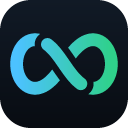
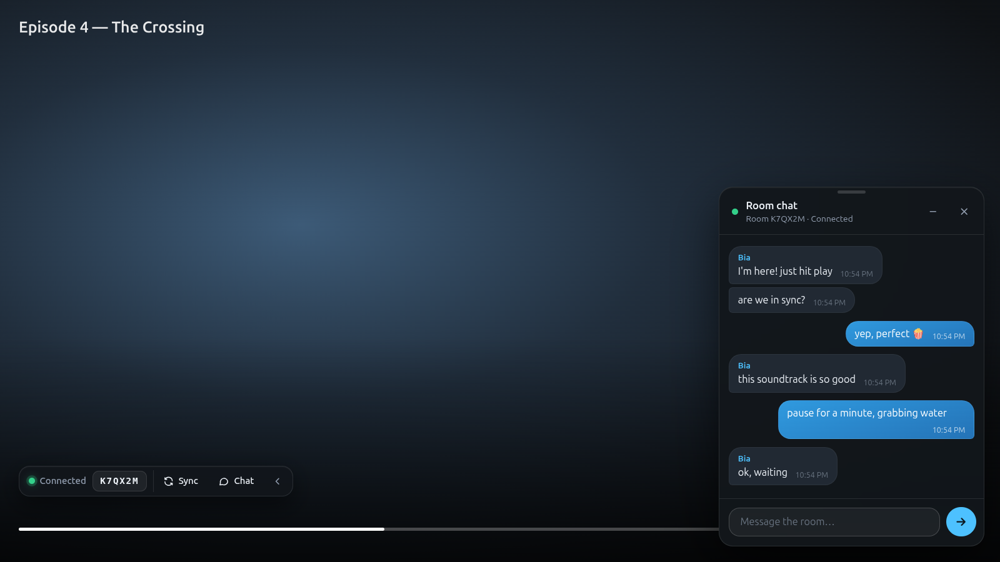
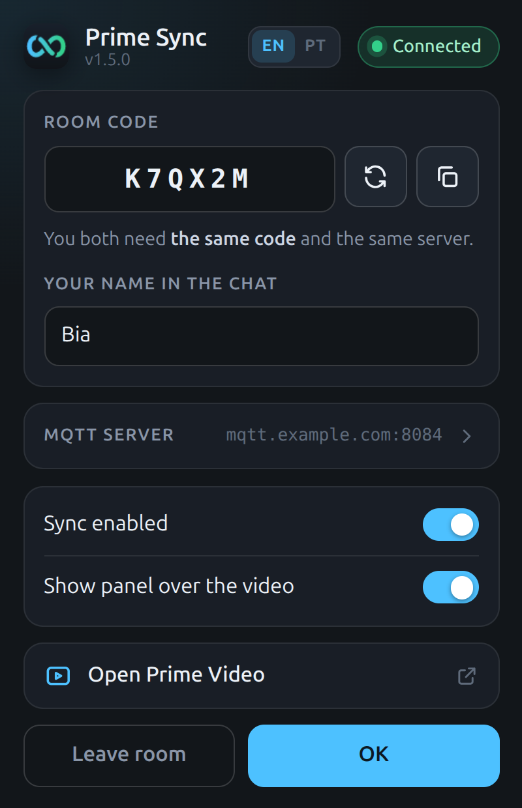

<p align="center">
  
</p>

<h1 align="center">Prime Sync</h1>

<p align="center">
  Watch Prime Video together, each person in their own home.<br>
  When one of you plays, pauses or skips, the other screen does the same.
</p>

<p align="center">
  <a href="LEIA-ME.md">🇧🇷 Português</a> · 🇺🇸 English
</p>

<p align="center">
  
</p>

> **Independent project.** Prime Sync has no connection with Amazon or Prime
> Video, is not endorsed by them, and holds no rights to the service, its
> trademarks or its content. Each person needs their own subscription (or the
> same account, within the plan's screen limit). The extension only talks to
> the player that is already open in your browser.

> The interface is in English by default, with Brazilian Portuguese available
> through the **EN | PT** switch at the top of the popup.

---

## Contents

1. [What you need](#what-you-need)
2. [Step 1 — Choose a server](#step-1--choose-a-server)
3. [Step 2 — Install the extension](#step-2--install-the-extension)
4. [Step 3 — Set it up](#step-3--set-it-up)
5. [Step 4 — Watch together](#step-4--watch-together)
6. [Room chat](#room-chat)
7. [What the pill shows](#what-the-pill-shows)
8. [Troubleshooting](#troubleshooting)
9. [Privacy and security](#privacy-and-security)
10. [Limitations](#limitations)
11. [For developers](#for-developers)
12. [License](#license)

---

## What you need

- **Chrome, Edge or Brave** on a computer (it does not work on phones or TVs).
- **Prime Video** open in the browser, on both computers.
- **An MQTT server** that both of you use (see Step 1).
- About **10 minutes** the first time. After that, just open and watch.

---

## Step 1 — Choose a server

Think of the server as a **mail carrier**: when you pause, the extension sends
it a note saying "paused at 12:30", and it delivers that note right away to the
other person's browser. The technical name for this carrier is an **MQTT
broker**.

The extension **does not ship with a server**. You pick one and both of you
use the same one. All you need from it is an **address that starts with
`wss://`** (and, if the service asks for one, a username and password).

| Option | Good for | Cost |
| --- | --- | --- |
| **Hosted cloud service** (for example, the free plan of HiveMQ Cloud or EMQX Cloud Serverless) | People who don't want to install anything | Free for two people |
| **Your own server** (Mosquitto on a computer or VPS you own) | People who already run servers | Whatever your server costs |
| **EMQX public broker** (`wss://broker.emqx.io:8084/mqtt`) | Trying it right now, without signing up | Free |

With a cloud service, the path is usually:

1. Create an account on the service's website.
2. Create a server on the free plan (sometimes called a *cluster* or *deployment*).
3. Create a **username and password** to connect (look for *credentials* or *authentication*).
4. Copy the **WebSocket over TLS** address. It starts with `wss://` and
   usually ends in `/mqtt`, for example
   `wss://abc123.example-mqtt.cloud:8884/mqtt`.

Keep the address, username and password. You will paste them in Step 3 and
send them to the other person.

> ⚠️ **About the EMQX public broker.** It is run by the company behind EMQX
> and is reliable, but it is **open**: anyone connected to it can see room
> codes, read the chat and send play/pause to you. Use it for testing, or if
> that does not bother you. The popup has a button that fills in this address,
> always with the warning. For private conversations, prefer a service with a
> username and password.

---

## Step 2 — Install the extension

Do this **on both computers**.

1. Get the `prime-sync-extension.zip` file (whoever built the package sends it
   by chat, Drive, etc.) and unzip it:
   - **Windows:** right-click the file → **Extract All** → **Extract**.
   - **Mac:** double-click the file.
2. Move the folder to a permanent place, such as **Documents**.
   ⚠️ Do not delete, move or rename this folder later. The extension runs
   straight from it.
3. Open the browser and type in the address bar:
   - Chrome: `chrome://extensions`
   - Edge: `edge://extensions`
   - Brave: `brave://extensions`
4. Turn on **Developer mode** (Chrome and Brave: top-right corner;
   Edge: left menu).
5. Click **Load unpacked** and choose the folder that has the `manifest.json`
   file inside it.
6. Pin the icon: click the **puzzle piece** in the browser toolbar, then the
   **pin** next to *Prime Sync*.

> The extension is not in the Chrome Web Store, so installation is manual.

---

## Step 3 — Set it up



Click the Prime Sync icon (the ∞ in the browser toolbar):

1. Open **MQTT server** and paste the **address** from Step 1. Fill in
   **Username** and **Password** if you have them. No server yet? The
   **Use broker.emqx.io anyway** button fills in the public one (read its
   warning).
2. In **Your name in the chat**, type how you want to appear.
3. In **Room code**, click the **arrows** button to create a code and the
   button next to it to **copy** it.
4. Send the other person the **room code**, the **server address** and, if
   any, the **username and password**. They fill in exactly the same on their
   computer.
5. Click **OK**. Everything is saved automatically.

The room code never expires. You can keep the same one forever.

<br clear="right">

---

## Step 4 — Watch together

1. Both of you open Prime Video **on the same episode or movie**.
2. If the Prime tab was already open before installing, press **F5** on it.
3. The Prime Sync **pill** shows up in the bottom-left corner of the video.
   **Green** dot and "Connected" = all good.
4. Press play. From then on, play, pause, skipping forward and back happen on
   both screens.
5. If it drifts out of step, click **Sync** on the pill.

To test it: pause on your screen and check that the other one pauses too.

---

## Room chat

- Click **Chat** on the pill to open the conversation next to the video.
- Type and press **Enter** to send (**Shift+Enter** for a new line).
- With the chat closed, new messages show up as a notice in the corner and as
  a counter on the **Chat** button.
- You can **minimize** it (the `–` button or a click on the title) and
  **resize** it by dragging the bar at the top. Double-click the bar to go
  back to the default size.
- **The conversation is not saved.** Close the tab and it is gone.

To hide everything, click the `‹` arrow on the pill. A handle stays on the
left edge of the screen; click it to bring the interface back.

---

## What the pill shows

| On screen | Meaning |
| --- | --- |
| 🟢 Connected | All good |
| 🟡 Connecting… | Trying to reach the server |
| 🟡 Set up the server / the room | Something is missing in the Prime Sync icon |
| 🔴 Offline | Could not reach the server |
| `⏸ Bia paused` | Who paused the video |
| `⚠ your connection` | **Your** internet is making the video stall |
| `⚠ Bia lagging` | The **other person's** internet is stalling |
| `⚠ Bia no signal` | No news from the other person for over 25 seconds |
| `+1.4s` | Time difference between the two screens (fixed automatically) |

---

## Troubleshooting

| What happens | Likely cause | What to do |
| --- | --- | --- |
| No "Load unpacked" button | Developer mode is off | Turn the switch on and reload the page |
| "Manifest file is missing or unreadable" | Wrong folder | Pick the folder that has `manifest.json` inside |
| The pill does not appear on the video | Tab opened before installing | Press F5 on the Prime Video tab |
| "Set up the server" | Address empty or incomplete | Paste the `wss://…` address in the Prime Sync icon |
| "The server refused the login" | Wrong username or password | Check both, letter by letter |
| "Could not reach the server" | Wrong address, internet, VPN or a network that blocks it | Check the address; try another network or turn the VPN off |
| One person pauses and the other doesn't | Different code or server | Make sure both are **identical** on both computers |
| "Click the player once to allow autoplay" | The browser blocked autoplay | Click the video once |
| "Disable developer mode extensions" balloon | Normal Chrome notice | Click **Cancel**. Don't disable it |
| Gone after restarting the computer | The folder was moved or deleted | Install again, pointing to the current folder |

**Updating to a new version:** unzip **over the same folder**, go to
`chrome://extensions`, click **⟳** on the Prime Sync card and press F5 on the
Prime Video tab. Your settings stay saved.

---

## Privacy and security

- **No account data** (email, password, card) goes through the extension.
- What travels through the server: the video position, whether it is playing
  or paused, the speed, the episode title, your chat name and the messages.
- Everything goes **only through the server you configured**. The extension
  talks to nothing else.
- The **room code works like a password** between the two of you. Don't
  share it.
- On a **public server without a password** (like the EMQX one), the code
  does not protect you: anyone connected can listen to every room at once and
  send commands. The popup shows a yellow warning while it is in use. For
  privacy, use a server with a username and password.
- The server username and password are stored in your browser, in the
  extension's local storage.

---

## Limitations

- **Ads:** during commercials the video time changes and sync may be lost.
  Click **Sync** when the episode comes back.
- **Autoplay:** if the browser blocks it, click the player once. That covers
  the rest of the session.
- **Small differences** are fixed by speeding up or slowing down the video by
  up to 8% for a few seconds, which you won't notice. Only differences above
  1.6s become a jump.
- **Supported regions:** `primevideo.com` and `amazon.com`, `.com.br`,
  `.co.uk`, `.de`, `.es` and `.com.mx` (`/gp/video/` pages). Another region?
  See below how to add it.

---

## For developers

### How it works

```
Browser A                                      Browser B
┌───────────────┐                            ┌───────────────┐
│ content.js    │ ◄── Prime Video player     │ content.js    │
│      │        │                            │      │        │
│ background.js │ ◄──── MQTT broker (WSS) ──►│ background.js │
└───────────────┘     configured by the user └───────────────┘
```

- `content.js` finds the player's `<video>`, publishes the local state and
  applies the remote state. It also draws the pill and the chat.
- `background.js` (service worker) keeps **one** MQTT connection and bridges
  it with the tabs.
- Topics: `primesync/v1/<CODE>` for sync and `primesync/v1/<CODE>/chat` for
  chat. Messages are JSON with `v: 1`.
- `mqtt-lite.js` is a minimal MQTT 3.1.1 client (QoS 0, username/password)
  with no dependencies.

| File | Role |
| --- | --- |
| `extension/manifest.json` | MV3 manifest, sites and permissions |
| `extension/background.js` | MQTT connection and bridge with tabs |
| `extension/mqtt-lite.js` | MQTT client over WebSocket |
| `extension/content.js` | Video sync, pill and chat |
| `extension/overlay.css` | Pill and chat styles |
| `extension/popup.*` | Settings window |
| `extension/i18n.js` | English and Portuguese texts |
| `test/mqtt-lite.test.cjs` | MQTT client tests, no network |
| `test/i18n.test.cjs` | Checks both languages have every text |
| `test/broker.integration.cjs` | Real test against a broker |
| `tools/room.cjs` | Terminal room monitor |
| `tools/make-icons.cjs` | Generates the PNG icons |
| `tools/check.cjs` | Validates manifest, versions and syntax |

### Commands

Requires Node.js 22 or newer. There are no dependencies to install.

```bash
npm test                 # offline MQTT client tests
npm run check            # manifest, versions and syntax

# real test and room monitor (need a broker)
BROKER=wss://your-broker:8884/mqtt BROKER_USER=user BROKER_PASS=pass npm run test:broker
BROKER=wss://your-broker:8884/mqtt npm run room -- K7QX2M
BROKER=wss://your-broker:8884/mqtt npm run room -- K7QX2M --say "hi"

npm run icons            # regenerate the icons
npm run zip              # build prime-sync-extension.zip (with README, LEIA-ME and LICENSE)
```

After editing, click **⟳** on the card in `chrome://extensions` and reload the
Prime Video tab.

### Your own broker with Mosquitto

```conf
# /etc/mosquitto/conf.d/prime-sync.conf
listener 8083
protocol websockets
allow_anonymous false
password_file /etc/mosquitto/passwd
```

```bash
sudo mosquitto_passwd -c /etc/mosquitto/passwd user
```

Put TLS in front of it (for example, a reverse proxy such as Caddy or Nginx)
to get a `wss://` address. Without TLS, use `ws://` only on a local network.

### Adding a language

Copy the `en` block in `extension/i18n.js`, translate the values and add a
button for it in `popup.html`. `npm test` fails if a key is missing.

### Another Prime Video region

Add the address pattern to `extension/manifest.json`, in both
`host_permissions` and `content_scripts.matches`.

---

## License

[GPL-3.0](LICENSE). You may use, study, modify and redistribute it, as long as
modified versions you distribute stay open under the same license.

Prime Video and Amazon are trademarks of Amazon.com, Inc. or its affiliates.
This project is not affiliated with, sponsored or endorsed by them.
